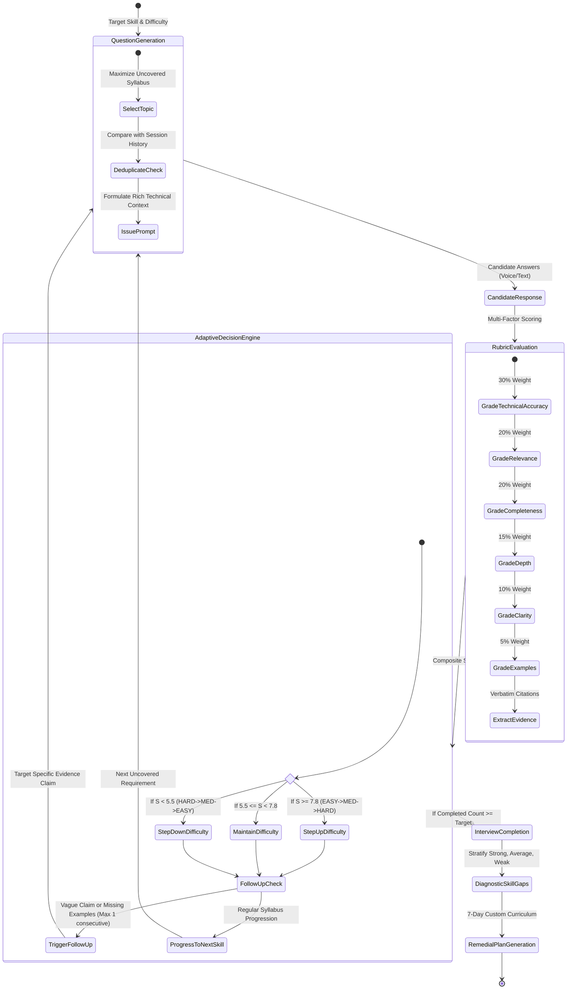

# ARCHITECTURE SPECIFICATION: AI MOCK INTERVIEW PLATFORM

## 1. Architectural Overview

The AI Mock Interview Platform follows a clean, decoupled, layered micro-architecture consisting of:
1. **Client Tier**: React 18, TypeScript, Tailwind CSS, Vite. Communicates asynchronously via REST over JSON.
2. **Gateway & API Tier**: FastAPI ASGI framework with dependency injection, JWT token authorization, and automated OpenAPI documentation.
3. **Core Services Tier**: Modular domain engines (`resume_parser`, `jd_analyzer`, `skill_matcher`, `interview_planner`, `question_generator`, `adaptive_engine`, `answer_evaluator`, `coding_evaluator`, `skill_gap`, `recommendation_engine`).
4. **AI Inference Abstraction Tier**: Provider interface (`BaseLLMProvider`) supporting Google Gemini (`gemini-1.5-flash`), OpenAI, or an offline heuristic mock provider (`MockLLMProvider`).
5. **Persistence Tier**: SQLAlchemy ORM with normalized relational models, supporting SQLite for local development and PostgreSQL for production clusters.

---

## 2. Adaptive Closed-Loop State Machine

Unlike conventional mock interview tools that generate a fixed array of questions, this system executes a dynamic cognitive feedback loop:



### Deterministic Difficulty Adaptation Formulation:
Let $S_{comp}$ be the composite score on a $0.0 \dots 10.0$ scale:
$$S_{comp} = 0.30 \cdot S_{tech} + 0.20 \cdot S_{rel} + 0.20 \cdot S_{comp} + 0.15 \cdot S_{depth} + 0.10 \cdot S_{clar} + 0.05 \cdot S_{ex}$$

- **Condition 1 (Excellence)**: If $S_{comp} \ge 7.8$, difficulty increases:
  $$\text{EASY} \longrightarrow \text{MEDIUM} \longrightarrow \text{HARD}$$
- **Condition 2 (Consolidation)**: If $S_{comp} < 5.5$, difficulty decreases:
  $$\text{HARD} \longrightarrow \text{MEDIUM} \longrightarrow \text{EASY}$$
- **Condition 3 (Equilibrium)**: If $5.5 \le S_{comp} < 7.8$, current difficulty is maintained.

---

## 3. Algorithmic Code Evaluation & AST Complexity Detection

The coding interview round combines safe sandbox execution with static code analysis using Python's Abstract Syntax Tree (`ast` module):

1. **Test Runner Sandbox**:
   - Executes user code against both **Visible Test Cases** and **Hidden Stress / Boundary Test Cases**.
   - Captures `stdout` and intercepts syntax errors and execution exceptions without crashing the worker process.
   - Measures execution time in milliseconds.

2. **AST Asymptotic Complexity Deduction**:
   - Analyzes loop nesting depth (`ast.For`, `ast.While`):
     - Maximum Nesting Depth = 0 $\implies \mathcal{O}(1)$
     - Maximum Nesting Depth = 1 $\implies \mathcal{O}(n)$
     - Maximum Nesting Depth = 2 $\implies \mathcal{O}(n^2)$
     - Maximum Nesting Depth $\ge 3 \implies \mathcal{O}(n^3)$
   - Detects explicit sorting function calls (`sort()`, `sorted()`) $\implies \mathcal{O}(n \log n)$.
   - Detects auxiliary collection allocation (`dict()`, `set()`, `list()`) $\implies \text{Space } \mathcal{O}(n)$, otherwise $\mathcal{O}(1)$.

3. **Composite Algorithmic Scoring**:
   $$\text{Final Coding Score} = 0.40 \cdot \text{Correctness} + 0.20 \cdot \text{Time Complexity} + 0.15 \cdot \text{Space Complexity} + 0.15 \cdot \text{Edge Cases} + 0.10 \cdot \text{Code Quality}$$

---

## 4. Database Relational Schema

```
+--------------------+       +--------------------+       +--------------------+
|       users        |       |      resumes       |       |    job_profiles    |
+--------------------+       +--------------------+       +--------------------+
| id (PK)            |<---+  | id (PK)            |<---+  | id (PK)            |<---+
| email (Unique)     |    |  | user_id (FK)       |    |  | user_id (FK)       |    |
| hashed_password    |    +--| candidate_name     |    +--| title              |    |
| full_name          |       | raw_text           |       | required_skills    |    |
| role               |       | extracted_skills   |       | preferred_skills   |    |
+--------------------+       +--------------------+       +--------------------+
          |                            |                            |
          +----------------------------+----------------------------+
                                       |
                                       v
                             +--------------------+
                             |    interviews      |
                             +--------------------+
                             | id (PK)            |
                             | user_id (FK)       |
                             | resume_id (FK)     |
                             | job_id (FK)        |
                             | interview_type     |
                             | current_difficulty |
                             | total_score        |
                             | tech_score         |
                             | comm_score         |
                             | coding_score       |
                             +--------------------+
                                 |         |
                  +--------------+         +--------------+
                  |                                       |
                  v                                       v
        +--------------------+                  +--------------------+
        |     questions      |                  |  coding_attempts   |
        +--------------------+                  +--------------------+
        | id (PK)            |<---+             | id (PK)            |
        | interview_id (FK)  |    |             | interview_id (FK)  |
        | question_text      |    |             | problem_title      |
        | difficulty         |    |             | user_code          |
        | is_follow_up       |    |             | tests_passed       |
        | parent_q_id (FK)---+    |             | detected_time_comp |
        +--------------------+    |             | final_score        |
                  |               |             +--------------------+
                  v               |
        +--------------------+    |
        |     responses      |    |
        +--------------------+    |
        | id (PK)            |    |
        | question_id (FK)---+    |
        | answer_text        |    |
        | duration_seconds   |    |
        | speech_metrics     |    |
        | video_metrics      |    |
        +--------------------+    |
                  |               |
                  v               |
        +--------------------+    |
        |    evaluations     |    |
        +--------------------+    |
        | id (PK)            |    |
        | response_id (FK)   |    |
        | relevance_score    |    |
        | tech_accuracy_score|    |
        | completeness_score |    |
        | depth_score        |    |
        | clarity_score      |    |
        | overall_score      |    |
        | strengths (JSON)   |    |
        | weaknesses (JSON)  |    |
        | evidence (JSON)    |    |
        | suggested_action   |    |
        +--------------------+    |
```
