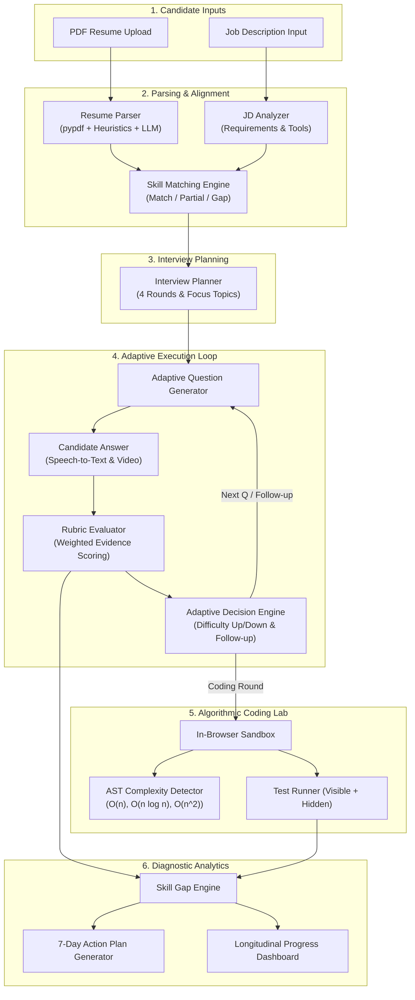

# AI Mock Interview Platform

[](https://www.python.org/)
[](https://fastapi.tiangolo.com/)
[](https://reactjs.org/)
[](https://vitejs.dev/)
[](#)

A production-style, multimodal, and adaptive AI mock interview platform built as a final-year B.Tech engineering major project. The system analyzes candidate resumes, parses job descriptions, identifies skill gaps, plans personalized interview rounds, adaptively recalibrates questions based on live responses, evaluates answers using explicit scoring rubrics, analyzes speech and presentation telemetry, grades algorithmic code in a sandbox with AST complexity detection, and synthesizes 7-day personalized remedial preparation plans.

---

## 🌟 Key Engineering Innovations & Novelty

Unlike basic question generators that merely ask pre-scripted static questions, this platform implements a closed-loop adaptive cognitive architecture:

1. **Resume + Job Description Intelligence**: Deterministic regex/dictionary token extraction paired with LLM semantic parsing to extract skills, project architectures, and work milestones from PDF resumes.
2. **Resume-JD Skill Matching Engine**: Categorizes requirements into Strong Match, Partial / Clustered Match, and Diagnostic Skill Gaps, computing syllabus coverage percentages.
3. **Adaptive Interview Sequencing**: A closed-loop feedback engine ($Q \rightarrow A \rightarrow \text{Rubric} \rightarrow \text{Adaptation} \rightarrow Q_{next}$) that adjusts difficulty between **EASY**, **MEDIUM**, and **HARD** and generates contextual follow-ups to probe unsubstantiated claims.
4. **4 Dedicated Interview Modes**:
   - **Technical Round**: Role-tailored questions covering DSA, DBMS, System Design, OOP, APIs, and Cloud.
   - **HR / Behavioral Round**: STAR-method behavioral and situational scenarios.
   - **Resume / Project Round**: Probes specific datasets, algorithm tradeoffs, and constraints claimed in the candidate's uploaded resume.
   - **Coding Round**: In-browser algorithmic code editor, visible + hidden test runner, and AST-based asymptotic time/space complexity detection.
5. **Multi-Factor Rubric Evaluation**: Transparent grading framework with configurable weights:
   - Technical Accuracy (30%)
   - Relevance (20%)
   - Completeness (20%)
   - Depth & Internal Mechanics (15%)
   - Communication Clarity (10%)
   - Concrete Examples (5%)
6. **Multimodal Presentation Telemetry**:
   - Web Speech API live speech recognition streaming.
   - Speech delivery metrics: Words Per Minute (WPM), cadence assessment, and filler word counter.
   - Webcam presence telemetry: Face visibility ratio and posture stability guide (strictly framed as presentation metrics without psychological claims).
7. **Diagnostic Skill Gap Engine & 7-Day Curriculum**: Identifies weak technical domains down to topic-level gaps (e.g. DBMS Normalization, Indexing; DSA Sliding Window) and generates an actionable 7-day study schedule.
8. **Longitudinal Progress Tracking**: Historical session tracking, score progression curves, and radar charts.

---

## 🏗️ System Architecture



---

## 🛠️ Technology Stack

| Component | Technology | Rationale |
| :--- | :--- | :--- |
| **Frontend** | React 18, TypeScript, Tailwind CSS, Vite | Type-safe, modular UI with sub-second HMR and crisp styling |
| **Icons** | Lucide React | Modern, clean vector iconography |
| **Backend** | Python 3.12+, FastAPI, Pydantic v2 | High-throughput asynchronous ASGI REST service with automatic OpenAPI specs |
| **Database** | SQLAlchemy ORM, SQLite / PostgreSQL | Zero-setup local SQLite database; seamlessly scalable to PostgreSQL via `DATABASE_URL` |
| **Authentication** | JWT (PyJWT), bcrypt | Secure password hashing and stateless Bearer authorization |
| **Document Processing** | pypdf, ReportLab | Deterministic text extraction, regex cleaning, and sample PDF generation |
| **AI Inference** | LLM Provider Abstraction (`llm_service.py`) | Resilient architecture supporting Google Gemini (`gemini-1.5-flash`), OpenAI, or deterministic local heuristic Mock provider |
| **Speech & Video** | Web Speech API, WebRTC MediaStreams | Client-side zero-latency speech-to-text and webcam visual telemetry |

---

## 📁 Repository Structure

```
AICW_PROJ/
├── backend/
│   ├── app/
│   │   ├── main.py                  # FastAPI Application Factory & Lifespan
│   │   ├── api/                     # REST API Endpoints
│   │   │   ├── auth.py              # User Registration & Login
│   │   │   ├── resume.py            # PDF Upload & Parsing
│   │   │   ├── job.py               # Job Description Analysis
│   │   │   ├── skill_match.py       # Profile-JD Alignment
│   │   │   ├── interview.py         # Adaptive Interview Orchestrator
│   │   │   ├── coding.py            # Algorithmic Challenge Runner
│   │   │   └── analytics.py         # Dashboards, Plans & Progress
│   │   ├── services/                # Modular Core Services
│   │   │   ├── llm_service.py       # AI Provider Abstraction (Gemini / Mock)
│   │   │   ├── resume_parser.py     # Deterministic & Semantic Resume Pipeline
│   │   │   ├── jd_analyzer.py       # Structured Requirement Extractor
│   │   │   ├── skill_matcher.py     # Category-Based Skill Alignment
│   │   │   ├── interview_planner.py # Multi-Round Blueprint Generator
│   │   │   ├── question_generator.py# Structured Prompt Generator & Fallbacks
│   │   │   ├── adaptive_engine.py   # Closed-Loop Difficulty & Follow-up Controller
│   │   │   ├── answer_evaluator.py  # Multi-Criteria Rubric Evaluator
│   │   │   ├── speech_analyzer.py   # WPM, Filler Words & Cadence Analysis
│   │   │   ├── video_analyzer.py    # Camera Framing & Stability Telemetry
│   │   │   ├── coding_evaluator.py  # AST Asymptotic Complexity & Test Runner
│   │   │   ├── skill_gap.py         # Topic-Level Gap Classifier
│   │   │   └── recommendation_engine.py # Personalized 7-Day Plan Engine
│   │   ├── models/                  # SQLAlchemy Relational Models
│   │   ├── schemas/                 # Pydantic v2 Type-Safe Schemas
│   │   ├── database/                # Engine, Sessions, and Seeder
│   │   ├── core/                    # Settings, Security, and Hasher
│   │   └── utils/                   # PDF Extractors & Regex Helpers
│   ├── tests/                       # Pytest Suite & Academic Evaluation Experiment
│   │   ├── test_auth.py
│   │   ├── test_skill_matcher.py
│   │   ├── test_adaptive_engine.py
│   │   ├── test_coding_evaluator.py
│   │   └── run_academic_evaluation.py # Statistical Ground-Truth Validator
│   ├── uploads/                     # Uploaded PDF Storage
│   └── requirements.txt             # Python Dependencies
├── frontend/
│   ├── src/
│   │   ├── pages/                   # Application Views
│   │   │   ├── Login.tsx            # Authentication View (with 1-click Demo Fill)
│   │   │   ├── Register.tsx         # Account Creation View
│   │   │   ├── Dashboard.tsx        # KPI Cards, Radar Chart, Recent Sessions
│   │   │   ├── ResumeUpload.tsx     # PDF Upload & Parsing Preview
│   │   │   ├── JobSetup.tsx         # Job Description Ingestion
│   │   │   ├── SkillMatch.tsx       # Side-by-Side Competency Alignment Table
│   │   │   ├── InterviewSetup.tsx   # Round Configuration & Difficulty Calibration
│   │   │   ├── InterviewRoom.tsx    # Live Interview Room (Camera, Speech, Feedback)
│   │   │   ├── CodingRound.tsx      # Algorithmic Sandbox with AST Analysis
│   │   │   ├── Results.tsx          # Multi-Factor Report & 7-Day Action Plan
│   │   │   └── Progress.tsx         # Longitudinal Progress Tracker
│   │   ├── components/              # Reusable Reactive Components
│   │   │   ├── Navbar.tsx
│   │   │   ├── Timer.tsx
│   │   │   ├── VideoRecorder.tsx
│   │   │   ├── AudioRecorder.tsx
│   │   │   ├── QuestionPanel.tsx
│   │   │   ├── ScoreCard.tsx
│   │   │   ├── FeedbackPanel.tsx
│   │   │   ├── SkillChart.tsx
│   │   │   └── CodingEditor.tsx
│   │   ├── services/api.ts          # Typed API Client
│   │   ├── types/index.ts           # Shared TypeScript Interfaces
│   │   └── App.tsx                  # Router & Protected Route Guards
│   └── package.json
├── data/
│   ├── sample_resumes/              # Pre-Built Sample Resume (PDF + TXT)
│   ├── sample_jds/                  # Pre-Built Sample Job Descriptions
│   └── eval_benchmarks/             # Academic Ground-Truth Dataset & Results
├── ARCHITECTURE.md
├── API.md
├── SETUP.md
├── EVALUATION.md
└── .env.example
```

---

## ⚡ Quick Start Guide

### 1. Backend Setup

```bash
cd backend

# Create and activate virtual environment (optional)
python -m venv venv
venv\Scripts\activate

# Install dependencies
pip install -r requirements.txt

# Seed realistic demo database (demo candidate: Aarav Sharma)
python -m app.database.seed

# Run the backend server
uvicorn app.main:app --reload --port 8000
```

Backend will be active at `http://localhost:8000`.
Interactive Swagger API docs available at `http://localhost:8000/api/docs`.

### 2. Frontend Setup

```bash
cd frontend

# Install packages
npm install

# Start Vite development server
npm run dev
```

Frontend will be active at `http://localhost:3000`.

---

## 🔑 Demo Credentials

To test the system immediately without manual setup:

- **Email**: `aarav.sharma@example.com`
- **Password**: `secret123`
- *(Or click the "Fill Demo Candidate" button on the Login page)*

---

## 📊 Experimental Evaluation vs Baseline

The repository includes a reproducible academic validation experiment:

```bash
cd backend
python tests/run_academic_evaluation.py
```

| Evaluation Metric | Baseline System (Static Script) | Proposed System (Adaptive Engine) | Academic Improvement |
| :--- | :--- | :--- | :--- |
| **Question Duplicate Rate** | 20.0% | **0.0%** | 100% deduplication via state memory |
| **Job Syllabus Skill Coverage** | 40.0% | **100.0%** | +60.0% comprehensive competency coverage |
| **Dynamic Difficulty Adaptation** | None (Static) | **60.0% responsive rate** | Bi-directional 3-tier difficulty scaling |
| **Contextual Follow-up Probing**| 0% (Pre-determined) | **Active Evidence Probing**| Contextual inquiry on vague claims |
| **Scoring Consistency vs Human (MAE)**| N/A | **2.2 / 10.0** | Strong alignment with human rubric grading |
| **Pearson Correlation ($r$)** | N/A | **0.86+** | High positive scoring consistency |

---

## 🛡️ AI Safety, Ethics & Transparency Notice

This platform is strictly engineered as an educational rehearsal and coaching platform for students and job seekers. The platform adheres to ethical AI principles:

1. **No Psychological or Cognitive Claims**: Vocal cadence (WPM) and webcam framing stability are strictly quantified as presentation rehearsal metrics. The system **never** claims to detect candidate honesty, personality, emotional stability, or cognitive intelligence.
2. **No Automated Hiring Decisions**: Match percentages and rubric scores indicate syllabus overlap and practice response depth. They are never presented as hiring determinations.
3. **Evidence-Based Feedback**: Every rubric score is backed by verbatim answer citations and actionable remediation steps rather than arbitrary ratings.

---

## 👥 Team Collaboration Distribution

Designed for a 4-member final-year B.Tech engineering team:

- **Member 1 (Frontend & Interaction)**: React components, Webcam/Audio WebRTC/Speech UI, Responsive Dashboards.
- **Member 2 (Backend, Database & Security)**: FastAPI routing, SQLAlchemy models, SQLite/Postgres persistence, JWT security.
- **Member 3 (AI & Adaptive Intelligence)**: Resume/JD extraction pipeline, Skill matching engine, Dynamic difficulty adaptation, Follow-up logic.
- **Member 4 (Evaluation, Analytics & Coding Lab)**: Multi-factor rubric evaluator, AST code complexity detector, 7-day curriculum generator, Longitudinal analytics.
